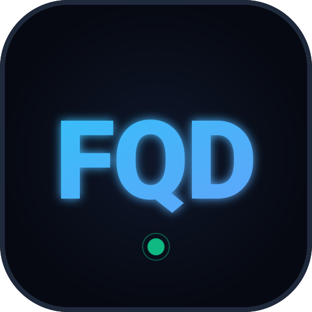
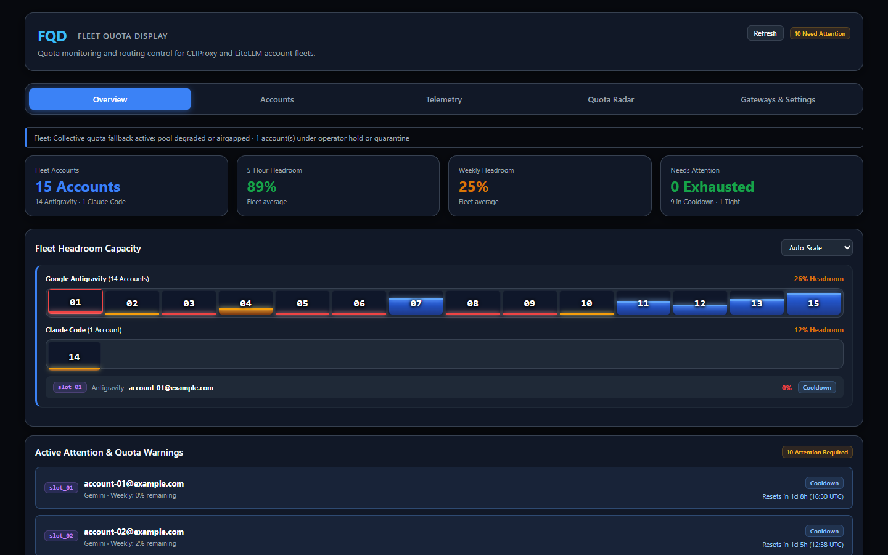

<div align="center">



# FQD — Fleet Quota Display

**Self-hosted quota monitoring and routing control for pools of AI subscription accounts behind CLIProxy and LiteLLM.**

<a href="LICENSE"></a>


<br/><br/>


<sub>Overview of a real 15-account fleet (email addresses anonymised).</sub>

</div>

---

## What FQD does

If you route coding agents through a pool of subscription accounts (Google Antigravity, Claude, ChatGPT/Codex, Gemini CLI) with [CLIProxy](https://github.com/router-for-me/CLIProxyAPI) or [LiteLLM](https://github.com/BerriAI/litellm), FQD tells you how much quota each account has left and can keep exhausted accounts out of the pool.

- **Per-account quota windows.** Reads the 5-hour and weekly limits each provider reports, with reset countdowns, burn rate and projected exhaustion time.
- **Four account states**, used the same way across every page. The levels come from the routing policy ([`deploy/policy.example.yaml`](deploy/policy.example.yaml)); the defaults below are for Pro accounts (Non-Pro: tight at 40%, exhausted at 5%).

  | State | Meaning |
  | :--- | :--- |
  | Healthy | Tightest window above the drain level (20%) |
  | Tight | Tightest window at or below the drain level (20%) |
  | Exhausted | At or below the hard stop (2%), or rate-limited, while still receiving traffic |
  | Cooldown | Taken out of the CLIProxy pool by FQD or an operator |

- **CLIProxy pool control.** Discovers the credentials CLIProxy is serving, then plans routing weights from headroom. In `shadow` mode (the default) it only logs what it would do; in `enforce` mode it sets weight 0 and disables exhausted accounts, and restores them after they recover. Operators can also take an account out of rotation by hand with Cooldown in the account panel.
- **Proxy telemetry.** Requests and tokens per account and model from CLIProxy.
- **Usage by alias.** Requests, failures, tokens and spend for each LiteLLM alias over today, 7 or 30 days, expandable to the models behind the alias and the CLIProxy accounts that served them. Providers seen only in LiteLLM (for example a DeepSeek API key) get their own overview row automatically.
- **Machine-readable output.** `GET /api/quota` (JSON) and `GET /metrics` (Prometheus) for dashboards and alerting.
- **Alerts.** Low-quota, reset and re-login alerts in the app, and optionally in Telegram.

### Data honesty

FQD never invents numbers. Percentages come from the providers' own usage endpoints; burn rates and exhaustion times are derived from how those percentages change between polls. When a provider does not report a window or a reset time, FQD shows "not reported" or "No data" rather than a placeholder. Quota polling only reads usage endpoints and never sends prompts.

---

## Quick start

### Docker

```bash
docker run -d --name fqd -p 1455:1455 \
  -e ADMIN_PASSWORD="$(openssl rand -hex 32)" \
  -e APP_SECRET="$(openssl rand -hex 32)" \
  -v fqd-data:/app/data \
  ghcr.io/piyushkumarjiit/fqd:latest
```

Open `http://localhost:1455` and sign in with `ADMIN_PASSWORD`. FQD refuses to start with weak or placeholder secrets.

Keep `APP_SECRET` safe: it encrypts the stored account credentials, and changing it makes them unreadable.

### Docker Compose (with HTTPS)

```bash
git clone https://github.com/piyushkumarjiit/FQD.git
cd FQD
cp .env.example .env            # set ADMIN_PASSWORD, APP_SECRET, SITE_ADDRESS
mkdir -p data && sudo chown -R 1000:1000 data

docker compose --profile public up -d     # public DNS name, Let's Encrypt certificate
docker compose --profile internal up -d   # LAN address, Caddy's internal CA
docker compose --profile direct up -d     # plain HTTP on PORT, behind your own proxy
```

`deploy/` also contains a systemd unit and an nginx example for running without Docker.

### Connecting gateways

All integrations are configured through environment variables; see [`.env.example`](.env.example) for the full list.

| Integration | Variables | Notes |
| :--- | :--- | :--- |
| CLIProxy | `CPA_BASE_URL`, `CPA_MANAGEMENT_KEY` | Account discovery, quota and routing. Plain `http://` is accepted only for loopback and private-network addresses. |
| CLIProxy request counts | `CPA_USAGE_POLL_SEC` | Needs `usage-statistics-enabled` in the CLIProxy config (v8+). |
| Routing mode | `CPA_ROUTING_MODE` | `off`, `shadow` (default) or `enforce`. Enforce requires CLIProxy's weighted round-robin strategy. Overrides the policy file's mode. |
| Routing policy | `CPA_WATERMARK_POLICY_FILE` | Optional YAML with the tight / exhausted levels and account tiers; see [`deploy/policy.example.yaml`](deploy/policy.example.yaml). |
| LiteLLM | `LITELLM_URL`, `LITELLM_KEY` | Usage by alias, model and provider. Use a read-only `proxy_admin_viewer` user key and not your master key. |
| Telegram | `TELEGRAM_BOT_TOKEN`, `TELEGRAM_CHAT_ID` | Optional alert channel. |

Accounts that CLIProxy does not serve can be added directly from the Accounts page.

For LiteLLM key, only use a read-only key and never your master key. You can create a user with the proxy_admin_viewer role and generate a key for it. FQD only reads LiteLLM's daily usage summary and model list; it never creates keys, changes settings or sends requests through your models, and the key is sent only to the LITELLM_URL you configure.

```bash
curl -X POST http://<litellm>:4000/user/new \
  -H "Authorization: Bearer MASTER_KEY" -H "Content-Type: application/json" \
  -d '{"user_role": "proxy_admin_viewer", "user_alias": "fqd-telemetry"}'
```
---

## Supported providers

| Provider | Windows read | Sign-in |
| :--- | :--- | :--- |
| Google Antigravity | 5-hour and weekly, per model family | Google OAuth |
| Claude (Pro / Max / Team) | 5-hour session and 7-day | Claude OAuth or session cookie |
| ChatGPT / Codex | 5-hour and weekly Codex limits, credits | ChatGPT OAuth or session cookie |
| Gemini CLI | Session and weekly | Google OAuth |
| Cursor, Copilot, Perplexity, Grok, Mistral, DeepSeek, Qwen, Groq, Poe | Whatever the service's usage page reports | Pasted request (recipe-based) |

Accounts discovered through CLIProxy are matched to these providers automatically.

---

## API

Both endpoints accept `Authorization: Bearer <token>`. `/api/quota` also accepts a signed-in browser session.

| Endpoint | Token | Notes |
| :--- | :--- | :--- |
| `GET /api/quota` | `API_TOKEN` | Filters: `provider=claude\|chatgpt\|antigravity` (repeatable), `source=cpa\|native\|all`. Supports `ETag` / `If-None-Match`. |
| `GET /metrics` | `METRICS_TOKEN`, or `API_TOKEN` if unset | Returns 404 when neither token is configured. Bearer only; cookies are rejected. |

### `GET /api/quota`

```bash
curl -H "Authorization: Bearer $API_TOKEN" http://localhost:1455/api/quota
```

Response (one account shown):

```json
{
  "version": 1,
  "generatedAt": "2026-11-05T07:22:21.251Z",
  "intervalSec": 900,
  "cpa": {
    "enabled": true,
    "lastDiscoveryAt": "2026-11-05T07:21:27.863Z",
    "lastDiscoveryOk": true,
    "routingMode": "shadow",
    "routingBlocked": null
  },
  "accounts": [
    {
      "id": "cpa-89d6c4a459d0b5d9",
      "name": "account-14@example.com",
      "provider": "claude",
      "source": "cpa",
      "cpa": { "authIndex": "89d6c4a459d0b5d9", "name": "account-14@example.com", "linkState": "linked" },
      "email": "account-14@example.com",
      "plan": "oauth",
      "status": "ok",
      "error": null,
      "fetchedAt": "2026-11-05T07:15:54.479Z",
      "ageSeconds": 387,
      "stale": false,
      "headroom": 0.13,
      "effectiveRemainingPct": 13,
      "windows": [
        {
          "id": "five_hour", "type": "session_5h",
          "usedPct": 30, "remainingPct": 70,
          "resetsAt": "2026-11-05T09:00:00.414516+00:00", "resetInSec": 5859,
          "burnPctPerHour": 10, "exhaustAt": "2026-11-05T14:20:50.715Z",
          "exhausted": false, "severity": "normal"
        },
        {
          "id": "seven_day", "type": "weekly_7d",
          "usedPct": 87, "remainingPct": 13,
          "resetsAt": "2026-11-05T13:00:00.414537+00:00", "resetInSec": 20259,
          "burnPctPerHour": 1.8, "exhaustAt": "2026-11-05T14:29:48.775Z",
          "exhausted": false, "severity": "warning"
        }
      ],
      "routing": { "planned": 0, "applied": null, "managed": true, "cooldown": false, "reason": "headroom" }
    }
  ]
}
```

### `GET /metrics`

Every account series carries `provider`, `account`, `auth_index` and `email` labels; window series add `window`.

| Metric | Type | Meaning |
| :--- | :--- | :--- |
| `alt_quota_used_ratio` / `alt_quota_remaining_ratio` | gauge | Fraction of each window used / left |
| `alt_quota_reset_timestamp_seconds` | gauge | When each window resets |
| `alt_quota_burn_ratio_per_hour` | gauge | Observed burn rate per window |
| `alt_quota_exhaust_timestamp_seconds` | gauge | Projected exhaustion time |
| `alt_account_headroom_ratio` | gauge | Headroom score used for routing |
| `alt_account_up` | gauge | 1 when the last poll succeeded and is fresh |
| `alt_account_last_success_timestamp_seconds` | gauge | Last successful poll |
| `alt_cpa_routing_weight` | gauge | Planned and applied CLIProxy weight |
| `alt_cpa_routing_writes_total`, `alt_cpa_routing_blocked` | counter / gauge | Routing write activity and blocks |
| `alt_cpa_credentials`, `alt_cpa_ignored_credentials`, `alt_cpa_requests_total`, `alt_cpa_discovery_last_success_timestamp_seconds` | mixed | CLIProxy discovery health |

The `alt_` prefix is kept from the project FQD is derived from so existing dashboards keep working.

Example alert:

```yaml
- alert: FleetAccountExhaustingSoon
  expr: alt_quota_exhaust_timestamp_seconds - time() < 3600
  labels: { severity: warning }
```

---

## Security

- **Encrypted credentials.** Stored tokens and cookies are encrypted with AES-256-GCM using a key derived from `APP_SECRET`.
- **Hardened container.** Read-only root filesystem, all Linux capabilities dropped, runs as the non-root `node` user (UID 1000).
- **Outbound guard.** Provider requests resolve hostnames first and refuse private or reserved addresses; CLIProxy and LiteLLM connections go only to the URLs you configure.
- **Sign-in protection.** Constant-time secret comparison, per-address and global throttling, CSRF checks on state-changing requests, optional `ALLOWED_HOSTS`.
- **Supply chain.** Multi-arch images are signed with keyless cosign and published with provenance and SBOM attestations; CI actions are pinned to commit SHAs.

Report vulnerabilities privately; see [CONTRIBUTING.md](CONTRIBUTING.md#reporting-security-issues).

---

## Development

Requires Node.js 22 or 24 (the server uses the built-in `node:sqlite`); CI tests both.

```bash
npm ci
npm run build            # server/dist/server.mjs and web/dist
npm test                 # full test suite
npm run typecheck:all    # shared code, server and web
```

See [docs/architecture.md](docs/architecture.md) for how the pieces fit together and [CONTRIBUTING.md](CONTRIBUTING.md) for the workflow.

---

## Acknowledgements

FQD is a substantially refactored derivative of [AI Limits Tracker](https://github.com/Rauan228/AI-Limits-Tracker) by [Rauan](https://github.com/Rauan228), used under the MIT License.

## License

[MIT](LICENSE) © 2026 [Piyush Kumar](https://github.com/piyushkumarjiit). Portions © 2026 Rauan.
