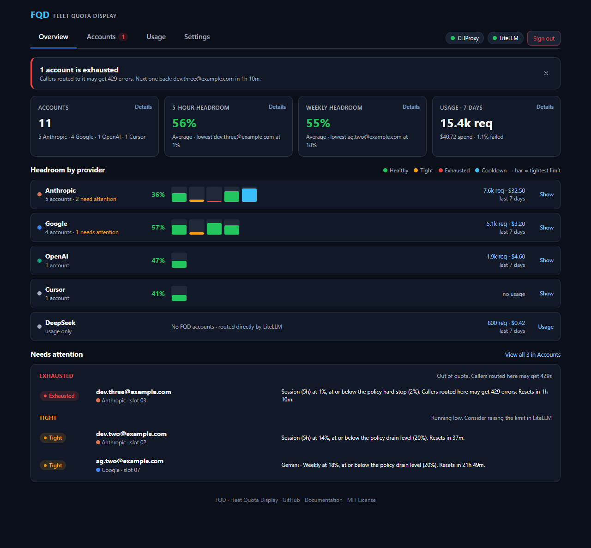
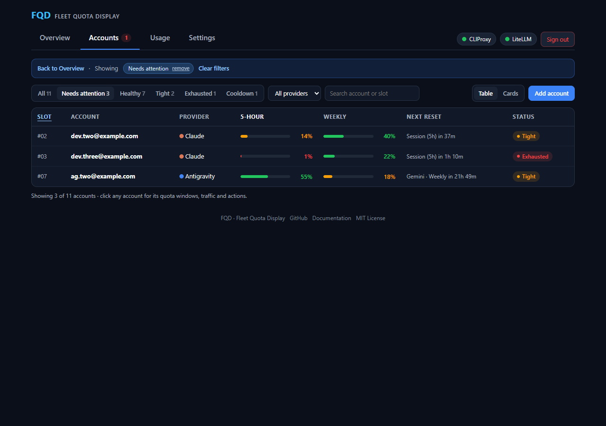
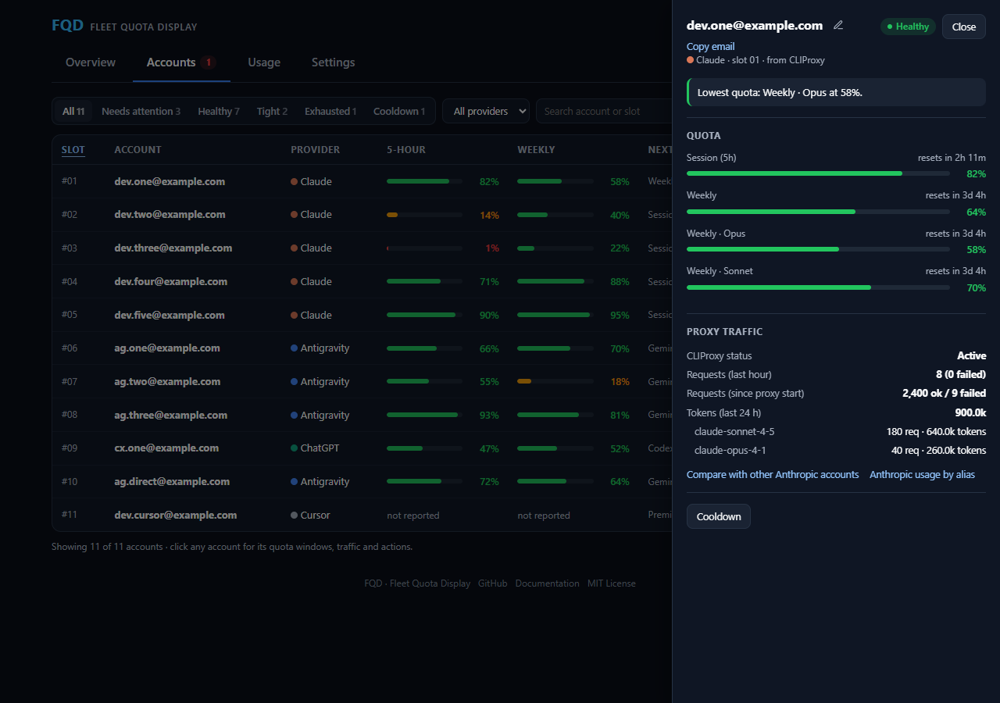
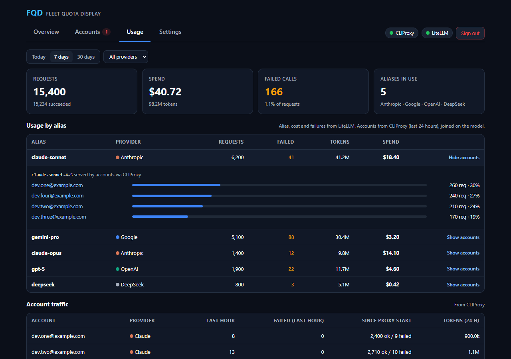
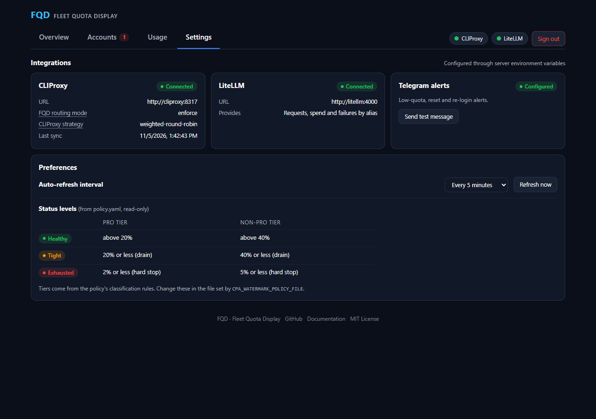
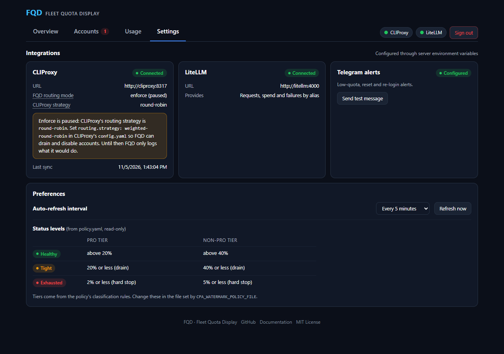

<div align="center">


# FQD — Fleet Quota Display

**Self-hosted quota monitoring and routing control for pools of AI subscription accounts behind CLIProxy and LiteLLM.**

<a href="LICENSE"></a>


<br/><br/>


<sub>The Overview page, shown with sample accounts.</sub>

</div>

---

## What FQD does

If you route coding agents through a pool of subscription accounts (Google Antigravity, Claude, ChatGPT/Codex, Gemini CLI) with [CLIProxy](https://github.com/router-for-me/CLIProxyAPI) or [LiteLLM](https://github.com/BerriAI/litellm), FQD shows how much quota each account has left and can take accounts out of the pool before they run dry.

- **Every quota window a provider reports**, with reset countdowns: 5-hour and weekly limits, per-model windows (Claude Opus / Sonnet, Antigravity Gemini and Claude/GPT), monthly or daily limits for other services.
- **One status per account, the same on every page**, decided by your routing policy:

  | Status | Meaning |
  | :--- | :--- |
  | Healthy | Tightest window above the policy's drain level |
  | Tight | At or below the drain level: running low |
  | Exhausted | At or below the hard stop, or rate-limited, while still in the pool: callers may get 429 errors |
  | Cooldown | Out of the CLIProxy pool, taken out by FQD's policy or by an operator |

- **Routing control for CLIProxy.** In `enforce` mode FQD drains accounts that are running low and disables exhausted ones, then brings them back after their quota resets. See [Routing policy and enforce mode](#routing-policy-and-enforce-mode).
- **Usage and spend.** Requests, failures, tokens and spend per LiteLLM alias, broken down to the models and CLIProxy accounts that served them, plus live request counts per account from CLIProxy.
- **Alerts** in Telegram when an account gets tight or exhausted, recovers, or needs signing in again.
- **Machine-readable output.** `GET /api/quota` (JSON) and `GET /metrics` (Prometheus).

### Data honesty

FQD never invents numbers. Percentages come from the providers' own usage endpoints; burn rates and exhaustion times are derived from how those percentages change between polls. When a provider does not report a window or a reset time, FQD says "not reported" rather than showing a placeholder. Quota polling only reads usage endpoints and never sends prompts.

---

## Quick start

### Docker

```bash
docker run -d --name fqd -p 1455:1455 \
  -e ADMIN_PASSWORD="$(openssl rand -hex 32)" \
  -e APP_SECRET="$(openssl rand -hex 32)" \
  -v fqd-data:/app/data \
  ghcr.io/piyushkumarjiit/fqd:latest
```

Open `http://localhost:1455` and sign in with `ADMIN_PASSWORD`. FQD refuses to start with weak or placeholder secrets.

Keep `APP_SECRET` safe: it encrypts the stored account credentials, and changing it makes them unreadable.

### Docker Compose (with HTTPS)

```bash
git clone https://github.com/piyushkumarjiit/FQD.git
cd FQD
cp .env.example .env            # set ADMIN_PASSWORD, APP_SECRET, SITE_ADDRESS
mkdir -p data && sudo chown -R 1000:1000 data

docker compose --profile public up -d     # public DNS name, Let's Encrypt certificate
docker compose --profile internal up -d   # LAN address, Caddy's internal CA
docker compose --profile direct up -d     # plain HTTP on PORT, behind your own proxy
```

`deploy/` also contains a systemd unit and an nginx example for running without Docker.

### Connecting gateways

All integrations are configured through environment variables; see [`.env.example`](.env.example) for the full list.

| Integration | Variables | Notes |
| :--- | :--- | :--- |
| CLIProxy | `CPA_BASE_URL`, `CPA_MANAGEMENT_KEY` | Account discovery, quota and routing. Plain `http://` is accepted only for loopback and private-network addresses. |
| CLIProxy request counts | `CPA_USAGE_POLL_SEC` | Needs `usage-statistics-enabled` in the CLIProxy config (v8+). |
| Routing policy | `CPA_WATERMARK_POLICY_FILE` | YAML with the status levels, account tiers and routing mode; see [`deploy/policy.example.yaml`](deploy/policy.example.yaml). Without a file FQD uses the defaults shown there. |
| Routing mode | `CPA_ROUTING_MODE` | `off`, `shadow` or `enforce`. Overrides the mode in the policy file. |
| LiteLLM | `LITELLM_URL`, `LITELLM_KEY` | Usage by alias, model and provider. Use a read-only key (see below), never your master key. |
| Telegram | `TELEGRAM_BOT_TOKEN`, `TELEGRAM_CHAT_ID` | Optional alert channel. |

Accounts that CLIProxy does not serve can be added directly from the Accounts page; FQD then signs in and polls them itself.

FQD only reads LiteLLM's daily usage summary and model list; it never creates keys, changes settings or sends requests through your models, and the key is sent only to `LITELLM_URL`. Create a read-only user for it:

```bash
curl -X POST http://<litellm>:4000/user/new \
  -H "Authorization: Bearer MASTER_KEY" -H "Content-Type: application/json" \
  -d '{"user_role": "proxy_admin_viewer", "user_alias": "fqd-telemetry"}'
```

---

## How to use FQD

FQD has four pages. Start on **Overview**: it answers whether anything needs you, and every number on it opens the page that explains it, already filtered to what you clicked. One account opens in a side panel without leaving the page. Filters live in the URL, so the browser's Back button works and a filtered view can be bookmarked or shared.

### Overview

- **Exhausted warning.** The only banner FQD shows: accounts out of quota that are still in the pool, and when the next one comes back. Click it to see those accounts, or dismiss it until another account runs out.
- **Four tiles.** Number of accounts, average 5-hour and weekly headroom (with the lowest account), and LiteLLM usage for the last 7 days. Each opens Accounts or Usage, sorted or filtered to match.
- **Headroom by provider.** One row per provider family, built from your accounts and LiteLLM usage. Each bar is one account (its tightest window, coloured by status); click a bar to open that account, click the row to list its accounts in place, or click the request count to see that provider's usage. Providers that only exist in LiteLLM (for example a DeepSeek API key) open Usage directly.
- **Needs attention.** Exhausted accounts first, then tight ones, each with the reason and reset time in plain words.

### Accounts



Every account in one list. Filter by status or provider, search by name, email or slot, sort by any column, and switch between the table and a card per account. When you arrive from the Overview, a bar at the top shows what you clicked; remove a filter there or go back.

### Account panel



Click any account to open it. The panel shows:

- **Why it has its status**, in one sentence.
- **One bar per quota window the provider reports**, in the provider's order and with its own labels.
- **Proxy traffic** from CLIProxy: requests in the last hour and since the proxy started, tokens in the last 24 hours, and requests per model.
- **Display name.** Click the pencil next to the name to rename the account in FQD.
- **Actions that apply to this account.** For CLIProxy accounts, **Cooldown** takes the account out of the pool immediately (weight 0 and disabled, in any routing mode) for 24 hours, and **Return to rotation** brings it back early. For accounts added directly in FQD, **Reconnect** signs in again and **Delete** removes the account and its stored credentials. CLIProxy accounts are managed in CLIProxy, so FQD does not offer Delete for them.

### Usage



Requests, spend, failures and tokens per LiteLLM alias for today, 7 or 30 days. Click an alias to see the models behind it and how its requests were shared across CLIProxy accounts (CLIProxy keeps the last 24 hours). Below, **Account traffic** lists live CLIProxy request counts per account.

### Settings



Connection status and address of CLIProxy and LiteLLM, the routing mode and CLIProxy's routing strategy, Telegram alerts (with a test message), how often FQD polls providers, **Refresh now**, and the status levels your policy uses. Connections are configured through environment variables, not here. The green or red dots next to CLIProxy and LiteLLM at the top of every page link to this page.

---

## Routing policy and enforce mode

FQD always computes a status for every account. Whether it also changes routing in CLIProxy depends on the routing mode:

| Mode | What FQD does |
| :--- | :--- |
| `off` | Leaves routing alone. |
| `shadow` (default) | Works out what it would change and records it, without touching CLIProxy. |
| `enforce` | Changes CLIProxy weights: drains accounts that are running low (weight 1, so sessions in progress finish while new sessions go elsewhere), disables exhausted ones (weight 0 and disabled), and ramps them back (25, 50, 100) after they recover. |

### Turning on enforce mode

1. **Switch CLIProxy to weighted round-robin.** FQD steers traffic by changing each credential's weight, and CLIProxy only honours weights with this strategy. In CLIProxy's `config.yaml`:

   ```yaml
   routing:
     strategy: "weighted-round-robin"   # not "round-robin" or "fill-first"
   ```

   Restart CLIProxy. Every credential starts with weight 1, so traffic is shared exactly as before until FQD changes a weight. Session affinity settings keep working.

2. **Write a policy file** (optional). Copy [`deploy/policy.example.yaml`](deploy/policy.example.yaml), set `CPA_WATERMARK_POLICY_FILE` to its path, and adjust the levels and tiers. FQD reloads the file when it changes.

3. **Watch it in `shadow` first.** Leave the mode at `shadow` for a while and check that the statuses on Accounts match what you expect.

4. **Set the mode to `enforce`**, in the policy file (`mode: enforce`) or with `CPA_ROUTING_MODE=enforce`.

If the mode is `enforce` but CLIProxy's strategy is not `weighted-round-robin`, FQD does not change any weights. Settings shows **enforce (paused)** with a notice, and the server log says so:



**Cooldown** in the account panel does not depend on the strategy: it disables the credential in CLIProxy directly, in any mode.

### Status levels and tiers

The policy sets two levels per tier, as percent of quota left in an account's tightest window:

| Level | Policy key | Status | In enforce mode | Default: Pro | Default: Non-Pro |
| :--- | :--- | :--- | :--- | :--- | :--- |
| Drain | `drainPct` | Tight | Weight 1 | 20% | 40% |
| Hard stop | `hardStopPct` | Exhausted | Weight 0, disabled | 2% | 5% |

Each level has a recovery point a little higher (`drainRecoveryPct`, `hardStopRecoveryPct`) so accounts do not flap in and out. FQD also stops an account early when its current burn rate would cross the hard stop before the next check. The same levels drive the status badges, bar colours and Telegram alerts, so what you see is what FQD does.

**Tiers** are FQD's own, not the provider's plans. Pro accounts serve traffic first. Non-Pro accounts are a fallback pool: they take traffic only when no Pro account of the same provider can, and they are allowed to run lower. Classification rules in the policy assign the tier by matching CLIProxy's credential file name, for any provider:

```yaml
classificationRules:
  - pattern: "*claude*"         # glob on the CLIProxy auth file name; first match wins
    provider: anthropic
    tier: non_pro
    modality: subscription_pool
    managed: true               # false = FQD never changes this account's weight
```

Without classification rules, every CLIProxy account is a managed Pro account. Once you write your own list, accounts that match none of your rules are left unmanaged.

---

## Supported providers

| Provider | Windows read | Sign-in |
| :--- | :--- | :--- |
| Google Antigravity | 5-hour and weekly, per model family | Google OAuth |
| Claude (Pro / Max / Team) | 5-hour session and 7-day | Claude OAuth or session cookie |
| ChatGPT / Codex | 5-hour and weekly Codex limits, credits | ChatGPT OAuth or session cookie |
| Gemini CLI | Session and weekly | Google OAuth |
| Cursor, Copilot, Perplexity, Grok, Mistral, DeepSeek, Qwen, Groq, Poe | Whatever the service's usage page reports | Pasted request (recipe-based) |

Accounts discovered through CLIProxy are matched to these providers automatically.

---

## API

Both endpoints accept `Authorization: Bearer <token>`. `/api/quota` also accepts a signed-in browser session.

| Endpoint | Token | Notes |
| :--- | :--- | :--- |
| `GET /api/quota` | `API_TOKEN` | Filters: `provider=claude\|chatgpt\|antigravity` (repeatable), `source=cpa\|native\|all`. Supports `ETag` / `If-None-Match`. |
| `GET /metrics` | `METRICS_TOKEN`, or `API_TOKEN` if unset | Returns 404 when neither token is configured. Bearer only; cookies are rejected. |

### `GET /api/quota`

```bash
curl -H "Authorization: Bearer $API_TOKEN" http://localhost:1455/api/quota
```

Response (one account shown):

```json
{
  "version": 1,
  "generatedAt": "2026-11-05T07:22:21.251Z",
  "intervalSec": 900,
  "cpa": {
    "enabled": true,
    "lastDiscoveryAt": "2026-11-05T07:21:27.863Z",
    "lastDiscoveryOk": true,
    "routingMode": "shadow",
    "routingBlocked": null
  },
  "accounts": [
    {
      "id": "cpa-89d6c4a459d0b5d9",
      "name": "account-14@example.com",
      "provider": "claude",
      "source": "cpa",
      "cpa": { "authIndex": "89d6c4a459d0b5d9", "name": "account-14@example.com", "linkState": "linked" },
      "email": "account-14@example.com",
      "plan": "oauth",
      "status": "ok",
      "error": null,
      "fetchedAt": "2026-11-05T07:15:54.479Z",
      "ageSeconds": 387,
      "stale": false,
      "headroom": 0.13,
      "effectiveRemainingPct": 13,
      "windows": [
        {
          "id": "five_hour", "type": "session_5h",
          "usedPct": 30, "remainingPct": 70,
          "resetsAt": "2026-11-05T09:00:00.414516+00:00", "resetInSec": 5859,
          "burnPctPerHour": 10, "exhaustAt": "2026-11-05T14:20:50.715Z",
          "exhausted": false, "severity": "normal"
        },
        {
          "id": "seven_day", "type": "weekly_7d",
          "usedPct": 87, "remainingPct": 13,
          "resetsAt": "2026-11-05T13:00:00.414537+00:00", "resetInSec": 20259,
          "burnPctPerHour": 1.8, "exhaustAt": "2026-11-05T14:29:48.775Z",
          "exhausted": false, "severity": "warning"
        }
      ],
      "routing": { "planned": 0, "applied": null, "managed": true, "cooldown": false, "reason": "headroom" }
    }
  ]
}
```

### `GET /metrics`

Every account series carries `provider`, `account`, `auth_index` and `email` labels; window series add `window`.

| Metric | Type | Meaning |
| :--- | :--- | :--- |
| `alt_quota_used_ratio` / `alt_quota_remaining_ratio` | gauge | Fraction of each window used / left |
| `alt_quota_reset_timestamp_seconds` | gauge | When each window resets |
| `alt_quota_burn_ratio_per_hour` | gauge | Observed burn rate per window |
| `alt_quota_exhaust_timestamp_seconds` | gauge | Projected exhaustion time |
| `alt_account_headroom_ratio` | gauge | Headroom score used for routing |
| `alt_account_up` | gauge | 1 when the last poll succeeded and is fresh |
| `alt_account_last_success_timestamp_seconds` | gauge | Last successful poll |
| `alt_cpa_routing_weight` | gauge | Planned and applied CLIProxy weight |
| `alt_cpa_routing_writes_total`, `alt_cpa_routing_blocked` | counter / gauge | Routing write activity and blocks |
| `alt_cpa_credentials`, `alt_cpa_ignored_credentials`, `alt_cpa_requests_total`, `alt_cpa_discovery_last_success_timestamp_seconds` | mixed | CLIProxy discovery health |

The `alt_` prefix is kept from the project FQD is derived from so existing dashboards keep working.

Example alert:

```yaml
- alert: FleetAccountExhaustingSoon
  expr: alt_quota_exhaust_timestamp_seconds - time() < 3600
  labels: { severity: warning }
```

---

## Security

- **Encrypted credentials.** Stored tokens and cookies are encrypted with AES-256-GCM using a key derived from `APP_SECRET`.
- **Hardened container.** Read-only root filesystem, all Linux capabilities dropped, runs as the non-root `node` user (UID 1000).
- **Outbound guard.** Provider requests resolve hostnames first and refuse private or reserved addresses; CLIProxy and LiteLLM connections go only to the URLs you configure.
- **Sign-in protection.** Constant-time secret comparison, per-address and global throttling, CSRF checks on state-changing requests, optional `ALLOWED_HOSTS`.
- **Supply chain.** Multi-arch images are signed with keyless cosign and published with provenance and SBOM attestations; CI actions are pinned to commit SHAs.

Report vulnerabilities privately; see [CONTRIBUTING.md](CONTRIBUTING.md#reporting-security-issues).

---

## Development

Requires Node.js 22 or 24 (the server uses the built-in `node:sqlite`); CI tests both.

```bash
npm ci
npm run build            # server/dist/server.mjs and web/dist
npm test                 # full test suite
npm run typecheck:all    # shared code, server and web
```

See [docs/architecture.md](docs/architecture.md) for how the pieces fit together and [CONTRIBUTING.md](CONTRIBUTING.md) for the workflow.

---

## Acknowledgements

FQD is a substantially refactored derivative of [AI Limits Tracker](https://github.com/Rauan228/AI-Limits-Tracker) by [Rauan](https://github.com/Rauan228), used under the MIT License.

## License

[MIT](LICENSE) © 2026 [Piyush Kumar](https://github.com/piyushkumarjiit). Portions © 2026 Rauan.
