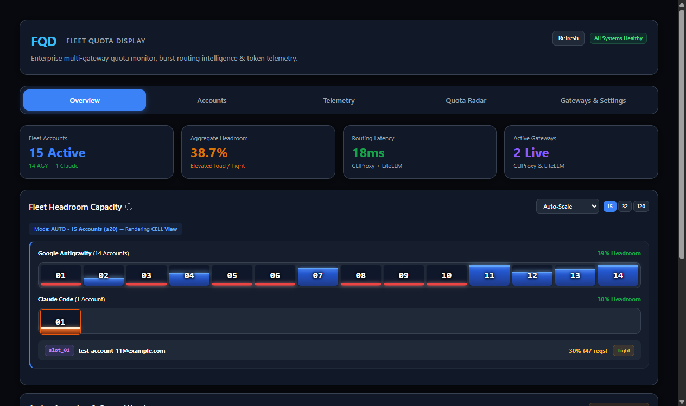

<div align="center">


# FQD — Fleet Quota Deck

**The unified observability deck and routing intelligence for AI subscription fleets, CLIProxy pools, and LiteLLM gateways.**

*Monitor 5-hour rolling bursts, 7-day weekly quota cycles, and multi-model burn rates before you hit provider limits. Self-hosted, private by design, with credentials staying on infrastructure you control.*

<a href="https://github.com/piyushkumarjiit/AI-Limits-Tracker"></a>


<br/><br/>


</div>

> **Lineage & Attribution**: FQD (Fleet Quota Deck) originated from [AI-Limits-Tracker](https://github.com/Rauan228/AI-Limits-Tracker) by Rauan under the MIT License, and has been extensively refactored into a high-concurrency fleet observability deck and routing engine for multi-account CLIProxy and LiteLLM gateway topologies.

---

## Why FQD?

Modern AI engineering workflows increasingly rely on multiple accounts, subscription tiers, and local proxy gateways:

1. **For Fleet Operators & AI Engineers:**
   You route agentic workloads through **CLIProxy** or **LiteLLM** across pools of accounts (Claude Max, ChatGPT Team/Pro, Google Antigravity). You need machine-readable headroom, predictive reset countdowns, and Prometheus metrics to steer traffic away from accounts nearing exhaustion and spill over cleanly to metered API keys.
2. **For Power Users & Developers:**
   You juggle multiple AI subscriptions (e.g. personal Claude, team Claude, Codex, Gemini) and need a single, honest dashboard instead of repeatedly logging in and out to check remaining window capacity.

---

## How the Numbers Are Honest

No major AI subscription exposes an arbitrary message counter, so **FQD never invents numbers**.
- **Ground-Truth Percentages:** It reads the exact rate-limit window percentages reported by official provider endpoints.
- **Derived Velocity:** Streaks, burn-rate forecasts ("will exhaust in 1h 40m"), and load classifications are derived from real window delta changes over time.
- **Transparent Health:** When a provider endpoint returns no data or fails to refresh, FQD explicitly marks the measurement as **stale** or **no data** — never a fabricated 0%.
- **Read-Only by Default:** Quota polling only reads usage and never issues generative prompts, placing zero overhead on your active quotas.

---

## Key Capabilities

- 📊 **Unified Multi-Horizon Radar:** Dual-horizon monitoring tracking short-term 5-hour rolling burst limits alongside 7-day weekly cycle balances.
- 👥 **Multi-Account Fleet Isolation:** Pool 10, 20, or 50+ accounts across Google Antigravity, Claude Code, and ChatGPT with fully isolated sessions, encryption, and token refreshes.
- ⏱ **Dynamic Reset Countdowns:** Precise rolling countdowns (e.g. `resets in 1h 14m (14:30 UTC)`) refreshed in real-time.
- 🚦 **Intelligent Gateway Integration:** Exposes normalized `/api/quota` JSON and Prometheus `/metrics` for dynamic routing in CLIProxy and LiteLLM.
- 📈 **30-Day Velocity Histograms:** Model-level token burn velocity (Gemini 2.5 Pro, Flash, Claude 3.7 Sonnet) with 30 discrete daily telemetry bars.
- 🔔 **Proactive Quota Warnings:** Automatically flags slots as **Exhausted** ($\le 15\%$), **Tight** ($\le 35\%$), or **Healthy** ($> 35\%$).
- 🔒 **Self-Hosted & Private:** All authentication tokens and cookies remain encrypted on your host (AES-256-GCM) with no third-party telemetry.

---

## Quickstart

### 1-Line Docker Run

Run FQD instantly on port 1455:

```bash
docker run -d \
  --name fqd \
  -p 1455:1455 \
  -e ADMIN_PASSWORD="your-strong-password" \
  -e APP_SECRET="$(openssl rand -hex 32)" \
  -v fqd-data:/app/data \
  ghcr.io/piyushkumarjiit/ai-limits-tracker:latest

# Open http://localhost:1455
```

### Production Deployment with Docker Compose

FQD includes production Caddy integration supporting automated Let's Encrypt certificates or internal LAN CAs:

```bash
git clone https://github.com/piyushkumarjiit/AI-Limits-Tracker.git
cd AI-Limits-Tracker

cp .env.example .env
# Edit .env and set:
#   ADMIN_PASSWORD=your-secure-password
#   APP_SECRET=$(openssl rand -hex 32)
#   SITE_ADDRESS=fqd.yourdomain.com (or local IP)

mkdir -p data && sudo chown -R 1000:1000 data

# Mode 1: Public domain with automatic Let's Encrypt TLS
docker compose --profile public up -d

# Mode 2: Local LAN / LXC with internal self-signed CA
docker compose --profile internal up -d

# Mode 3: Direct HTTP on port 1455 (behind your own reverse proxy)
docker compose --profile direct up -d
```

---

## Machine-Readable API & Integrations

### 1. Unified Quota Endpoint (`GET /api/quota`)

Returns normalized headroom, burst window states, and reset countdowns across your entire fleet:

```bash
curl -H "Authorization: Bearer <ADMIN_PASSWORD_OR_API_TOKEN>" http://localhost:1455/api/quota
```

#### Sample Response:
```json
{
  "summary": {
    "total_accounts": 15,
    "active_accounts": 15,
    "aggregate_headroom_pct": 38.6,
    "status": "tight"
  },
  "accounts": [
    {
      "id": "antigravity:test-account-01@example.com",
      "slot": "03",
      "provider": "antigravity",
      "email": "test-account-01@example.com",
      "burst_5h": {
        "remaining_pct": 6,
        "status": "exhausted",
        "requests_remaining": 9,
        "resets_in": "1h 14m",
        "reset_at": 1793725800
      },
      "cycle_7d": {
        "balance_pct": 97,
        "status": "healthy",
        "reset_at": 1793985000
      },
      "routing_weight": 0.06
    },
    {
      "id": "claude:test-account-02@example.com",
      "slot": "01",
      "provider": "claude",
      "email": "test-account-02@example.com",
      "burst_5h": {
        "remaining_pct": 30,
        "status": "tight",
        "requests_remaining": 47,
        "resets_in": "2h 45m",
        "reset_at": 1793731800
      },
      "routing_weight": 0.30
    }
  ]
}
```

---

### 2. Prometheus Metrics (`GET /metrics`)

FQD exports native Prometheus metrics designed for Grafana dashboards and Alertmanager rules:

```
# HELP alt_account_headroom_ratio Normalized headroom score [0, 1]
# TYPE alt_account_headroom_ratio gauge
alt_account_headroom_ratio{provider="antigravity",slot="03",account="test_account_01"} 0.06
alt_account_headroom_ratio{provider="claude",slot="01",account="test_account_02"} 0.30

# HELP alt_quota_window_remaining_ratio Remaining fraction of rate limit window [0, 1]
# TYPE alt_quota_window_remaining_ratio gauge
alt_quota_window_remaining_ratio{provider="antigravity",window="5h",slot="03"} 0.06
alt_quota_window_remaining_ratio{provider="antigravity",window="7d",slot="03"} 0.97

# HELP alt_quota_window_reset_timestamp_seconds Epoch timestamp of next window reset
# TYPE alt_quota_window_reset_timestamp_seconds gauge
alt_quota_window_reset_timestamp_seconds{provider="antigravity",window="5h",slot="03"} 1793725800

# HELP alt_cpa_routing_weight Calculated load routing weight
# TYPE alt_cpa_routing_weight gauge
alt_cpa_routing_weight{provider="antigravity",slot="03",kind="applied"} 0.06
```

---

### 3. LiteLLM Proxy Integration

#### The Challenge:
LiteLLM excels at routing across models and API keys, but standard API-key routing is blind to subscription rate limits (e.g. Claude 5-hour rolling windows). Routing high volume blindly into subscriptions causes unexpected HTTP 429 errors.

#### The Solution: Subscription-First Routing with Metered Fallback
Use FQD's routing weights to exhaust fixed-price subscription pools first, dynamically diverting traffic to metered pay-per-token keys only when subscription headroom drops below safety thresholds:

```
                  ┌──────────────────────────────────────────────┐
                  │                 LiteLLM Proxy                │
                  └──────────────────────┬───────────────────────┘
                                         │
             ┌───────────────────────────┴───────────────────────────┐
             ▼ (Primary: Headroom > 15%)                             ▼ (Spillover: Headroom <= 15%)
┌─────────────────────────────────────────┐             ┌─────────────────────────────────────────┐
│     FQD-Monitored CLIProxy Pool         │             │          Direct API Key Fallback        │
│   (Claude Pro / Max / Antigravity)      │             │         (Pay-per-token Anthropic)       │
└────────────────────┬────────────────────┘             └─────────────────────────────────────────┘
                     │
                     ▼
         [ Ground Truth Telemetry ]
           FQD Polling & Radar
```

#### Dynamic Routing Configuration:
LiteLLM can query FQD's `/api/quota` via a lightweight routing hook or sidecar to dynamically adjust deployment weights:

```yaml
# litellm_config.yaml
model_list:
  # Primary Subscription Pool (CLIProxy endpoint)
  - model_name: claude-3-7-sonnet
    litellm_params:
      model: openai/claude-3-7-sonnet
      api_base: http://cliproxy.internal:8317/v1
      api_key: os.environ/CPA_ACCESS_TOKEN
    model_info:
      fqd_slot: "01"
      tier: "subscription_pool"

  # Spillover Metered Key (Invoked only on subscription exhaustion)
  - model_name: claude-3-7-sonnet
    litellm_params:
      model: anthropic/claude-3-7-sonnet-20250219
      api_key: os.environ/ANTHROPIC_DIRECT_KEY
    model_info:
      tier: "spillover_metered"

router_settings:
  routing_strategy: "latency-based-routing"
  fallbacks: [{"claude-3-7-sonnet": ["claude-3-5-haiku"]}]
```

---

## Supported Providers & Modalities

| Provider | Supported Rate-Limit Windows | Telemetry Tracked | Auth Mechanics |
| :--- | :--- | :--- | :--- |
| **Google Antigravity** | 5-Hour Rolling Burst · 7-Day Cycle Limit | Velocity (Gemini 2.5 Pro / Flash), daily slots | Cloud Code OAuth refresh token |
| **Claude Code / Anthropic** | 5-Hour Session Burst · 7-Day Rolling Budget | Pro/Team tier headroom, reset epoch | Session cookie (`sessionKey`) / CLI token |
| **ChatGPT / OpenAI Codex** | 5-Hour Codex Window · Weekly Cap · Credits | Reasoning quota, Plus/Team limit status | Session token / Access token |
| **Google Gemini CLI** | Session Limit · Weekly Horizon | Per-slot request volume & balance | OAuth refresh token |

---

## Security Architecture

FQD is designed from the ground up for zero-trust environments:
- **AES-256-GCM at Rest:** All stored credentials and session tokens are encrypted with unique initialization vectors (`APP_SECRET`).
- **Read-Only Enclosure:** The Docker container operates with a read-only root filesystem, dropped Linux capabilities, and runs as non-root user `node` (UID 1000).
- **Outbound SSRF Protection:** Polling client restricts outbound network requests strictly to verified provider endpoints (`*.anthropic.com`, `*.google.com`, `*.openai.com`, or configured local proxy hosts).
- **Supply Chain Security:** Signed multi-arch container images published with keyless cosign, SBOM attestations, and SHA-pinned CI GitHub Actions.

---

## Verification & Testing

Run the test suite across core parsers, API endpoints, and cryptographic security boundaries:

```bash
# Run unit & isolation tests
npm test

# Typecheck all monorepo workspaces (server, web, extension)
npm run typecheck:all

# Security & deployment tests
npm run test:security
```

---

## License & Attribution

MIT License © 2026 [Piyush Kumar](https://github.com/piyushkumarjiit)

Based upon and substantially modernized from the original [AI Limits Tracker](https://github.com/Rauan228/AI-Limits-Tracker) by Rauan:
Copyright (c) 2026 Rauan

<div align="center"><sub>Fleet Quota Deck — High-integrity capacity observability for modern AI stacks.</sub></div>
